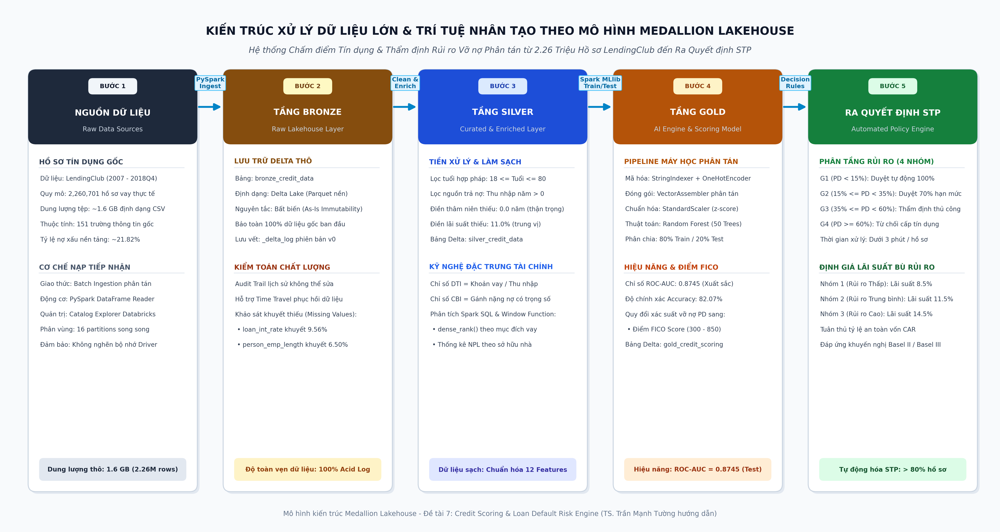

# CHƯƠNG 2: LƯỢC KHẢO TÀI LIỆU

---

## 2.1 Tổng quan về rủi ro tín dụng và phương pháp thẩm định truyền thống

### 2.1.1 Bản chất kinh tế của rủi ro tín dụng và biến cố vỡ nợ
Trong hoạt động trung gian tài chính, rủi ro tín dụng phát sinh từ hiện tượng **bất cân xứng thông tin (Asymmetric Information)** giữa người đi vay và bên cho vay, dẫn đến hai hệ lụy kinh điển là lựa chọn đối nghịch (Adverse Selection) trước khi ký hợp đồng và rủi ro đạo đức (Moral Hazard) sau khi giải ngân [9]. Theo Stiglitz và Weiss (1981), việc nâng lãi suất để bù đắp rủi ro có thể vô tình loại bỏ các khách hàng tốt và chỉ thu hút những đối tượng sẵn sàng mạo hiểm, làm tăng nguy cơ vỡ nợ của toàn danh mục [10]. 

Khi biến cố vỡ nợ xảy ra, ngân hàng không chỉ tổn thất phần vốn gốc chưa thu hồi mà còn phải gánh chịu chi phí xử lý nợ, trích lập dự phòng rủi ro và làm suy giảm tỷ lệ an toàn vốn CAR theo quy định của Ngân hàng Nhà nước [11]. Do đó, việc xây dựng mô hình dự báo xác suất vỡ nợ (Probability of Default - PD) chính xác là nền tảng sống còn trong quản trị tài chính hiện đại.

### 2.1.2 Các hạn chế của phương pháp thẩm định tín dụng truyền thống
Quy trình thẩm định truyền thống chủ yếu dựa trên đánh giá định tính của chuyên viên tín dụng (Expert Judgment) hoặc các bảng điểm tĩnh (Scorecards) xây dựng bằng hồi quy Logistic đơn biến [12]. Các phương pháp này bộc lộ những hạn chế rõ rệt:
1. **Độ trễ thời gian lớn:** Mất từ 2 đến 5 ngày để thẩm định hồ sơ giấy tờ và gọi điện xác minh, không đáp ứng được yêu cầu phê duyệt tức thì của khách hàng số.
2. **Chi phí vận hành cao:** Đòi hỏi lực lượng nhân sự thẩm định thực địa đông đảo, khiến biên lợi nhuận của các khoản vay nhỏ bị bào mòn.
3. **Định kiến chủ quan:** Quyết định phê duyệt phụ thuộc vào cảm tính cá nhân, dễ tạo ra sự thiếu nhất quán giữa các chi nhánh.
4. **Không nắm bắt được quan hệ phi tuyến:** Không xử lý được các mối quan hệ tương tác phức tạp giữa các đặc trưng tài chính đa chiều.

---

## 2.2 Cơ sở lý thuyết về Kiến trúc Hồ dữ liệu Databricks Lakehouse

### 2.2.1 Sự tiến hóa từ Data Warehouse đến Lakehouse
Để giải quyết bài toán dữ liệu lớn, kiến trúc lưu trữ và xử lý đã trải qua ba thế hệ tiến hóa: Kho dữ liệu (Data Warehouse), Hồ dữ liệu (Data Lake) và Kiến trúc kết hợp Hồ - Kho dữ liệu (Lakehouse) [13]:

**Bảng 2.1 So sánh ưu nhược điểm giữa Data Warehouse, Data Lake và Databricks Lakehouse**

| Tiêu Chí So Sánh | Kho Dữ Liệu Truyền Thống (Data Warehouse) | Hồ Dữ Liệu Thế Hệ Đầu (Data Lake) | Kiến Trúc Databricks Lakehouse (Đề Tài Áp Dụng) |
| :--- | :--- | :--- | :--- |
| **Cấu trúc Dữ liệu** | Chỉ lưu trữ dữ liệu có cấu trúc (Schema-on-write). | Dữ liệu phi cấu trúc, bán cấu trúc (Schema-on-read). | Hỗ trợ toàn diện dữ liệu cấu trúc, bán cấu trúc và phi cấu trúc. |
| **Đảm bảo Giao dịch ACID** | Hỗ trợ giao dịch ACID rất tốt trên hệ cơ sở dữ liệu quan hệ. | Không hỗ trợ ACID; dễ xảy ra xung đột khi ghi/đọc song song. | Hỗ trợ ACID đầy đủ thông qua tệp nhật ký giao dịch Delta Lake. |
| **Khả năng Mở rộng Quy mô** | Chi phí nâng cấp phần cứng (Scale-up) rất đắt đỏ, khó mở rộng. | Tận dụng lưu trữ đám mây giá rẻ (S3, ADLS, DBFS), mở rộng vô hạn. | Tách rời độc lập giữa Lưu trữ (Storage) và Năng lực tính toán (Compute). |
| **Nền tảng Hỗ trợ Trí tuệ Nhân tạo** | Hạn chế, chỉ hỗ trợ SQL và các báo cáo BI truyền thống. | Hỗ trợ tốt cho Machine Learning nhưng thiếu kiểm soát chất lượng. | Hỗ trợ trực tiếp từ SQL Analytics, BI Dashboard đến Spark MLlib Pipeline. |

<em>(Nguồn: Tổng hợp từ Armbrust et al., 2021 và Databricks Inc., 2023)</em>

### 2.2.2 Định dạng lưu trữ phân tán Delta Lake và Apache Spark
Delta Lake là tầng lưu trữ mã nguồn mở trung gian xây dựng trên nền tảng tệp Parquet dạng cột, mang lại các ưu thế vượt trội:
- **Tính toàn vẹn giao dịch ACID:** Đảm bảo mọi giao dịch thêm mới, cập nhật hoặc xóa dữ liệu đều thành công trọn vẹn hoặc hoàn tác hoàn toàn, ngăn ngừa hiện tượng phân mảnh dữ liệu (Data Corruption) [14].
- **Khả năng quay ngược thời gian (Time Travel):** Cho phép truy vấn dữ liệu tại một thời điểm lịch sử chính xác thông qua nhật ký `_delta_log`, đáp ứng yêu cầu kiểm toán nghiêm ngặt của ngành ngân hàng.
- **Tối ưu hóa truy vấn Spark Catalyst Optimizer:** Tự động tối ưu hóa kế hoạch thực thi logic và vật lý, giảm thiểu dung lượng truyền tải qua mạng giữa các worker node.

---

## 2.3 Thiết kế kiến trúc phân tầng Medallion trong định chế tài chính

### 2.3.1 Phân định chức năng ba tầng Bronze, Silver và Gold
Kiến trúc Medallion tổ chức luồng dữ liệu theo ba cấp độ tinh chế tăng dần nhằm bảo đảm chất lượng dữ liệu phục vụ mô hình học máy [15]:

**Bảng 2.2 Phân định chức năng, nguyên tắc và công nghệ giữa 3 tầng kiến trúc Medallion**

| Tầng Kiến Trúc | Bảng Delta Thực Tế Trong Đề Tài | Nguyên Tắc Quản Trị Dữ Liệu | Công Nghệ & Thao Tác Kỹ Thuật | Vai Trò Nghiệp Vụ Tín Dụng |
| :--- | :--- | :--- | :--- | :--- |
| **Tầng Bronze (Thô - Raw)** | `workspace.default.bronze_credit_data` | Bảo toàn nguyên vẹn 100% dữ liệu gốc, không chỉnh sửa, lưu vết đầy đủ. | `spark.read.csv()`, ghi Delta Table, khởi tạo nhật ký `_delta_log`. | Nguồn dữ liệu kiểm toán (Audit Trail) và phục hồi khi xảy ra sự cố. |
| **Tầng Silver (Làm sạch & Chuẩn hóa)** | `workspace.default.silver_credit_data` | Dữ liệu được làm sạch, xử lý ngoại lai, loại bỏ trùng lặp và giàu đặc trưng. | `.na.fill()`, `.filter()`, tính chỉ số DTI, CBI, Spark SQL Window Functions. | Phục vụ phân tích khám phá (EDA), thống kê báo cáo nội bộ và chuẩn bị tập huấn luyện. |
| **Tầng Gold (Kinh doanh & Mô hình hóa)** | `workspace.default.gold_credit_scoring` | Dữ liệu sẵn sàng cho hoạt động kinh doanh và tự động hóa ra quyết định. | Spark MLlib Pipeline, VectorAssembler, RandomForest, FICO Score. | Cung cấp điểm tín dụng, phân tầng hạn mức và định giá lãi suất theo rủi ro. |

<em>(Nguồn: Tổng hợp theo chuẩn Databricks Medallion Architecture)</em>

### 2.3.2 Sơ đồ luồng xử lý dữ liệu phân tán toàn diện
Toàn bộ luồng xử lý dữ liệu từ nạp dữ liệu thô đến xuất bản kết quả mô hình được mô tả trực quan trong sơ đồ sau:

<strong>Hình 2.1 Sơ đồ kiến trúc xử lý luồng dữ liệu Lakehouse theo mô hình Huy chương Medallion</strong>

<em>(Nguồn: Tác giả thiết kế dựa trên nền tảng Databricks Lakehouse)</em>

---

## 2.4 Khung quản trị dữ liệu và Chuẩn mực an toàn vốn Basel II/III

### 2.4.1 Tổng quan các nghiên cứu thực nghiệm trong và ngoài nước
Trong nhiều năm qua, các phương pháp phân loại nhị phân đã được áp dụng rộng rãi trong xếp hạng tín dụng cá nhân:
- Altman (1968) tiên phong với chỉ số Z-score dựa trên phân tích biệt số đa biến (MDA) để dự báo nguy cơ phá sản [16].
- Baesens et al. (2003) và Lessmann et al. (2015) qua các nghiên cứu thực nghiệm quy mô lớn đã chứng minh rằng các mô hình học kết hợp (Ensemble Learning) như Random Forest và Gradient Boosting luôn vượt trội so với hồi quy Logistic truyền thống về chỉ số AUC và khả năng kháng hiện tượng quá khớp (Overfitting) [17], [18].
- Jagtiani và Lemieux (2019) khẳng định dữ liệu phi truyền thống kết hợp máy học giúp các nền tảng FinTech nâng cao khả năng tiếp cận vốn cho người yếu thế mà không làm tăng tỷ lệ nợ xấu [19].

### 2.4.2 Yêu cầu tuân thủ an toàn vốn theo chuẩn Basel II/III và Thông tư 41/2016/TT-NHNN
Ủy ban Basel về Giám sát Ngân hàng quy định phương pháp xếp hạng nội bộ nâng cao (Advanced Internal Ratings-Based - A-IRB) đòi hỏi ngân hàng phải tự lượng hóa xác suất vỡ nợ (PD), tỷ lệ tổn thất khi vỡ nợ (LGD) và tổng dư nợ chịu rủi ro (EAD) [20]. Theo Thông tư 41/2016/TT-NHNN của Ngân hàng Nhà nước Việt Nam:
- Mô hình chấm điểm tín dụng phải được kiểm định chéo độc lập và có khả năng phân biệt rõ ràng giữa các nhóm khách hàng có mức độ rủi ro khác nhau.
- Tổ chức tín dụng phải trích lập dự phòng tổn thất tín dụng kỳ vọng ($EL$) theo công thức:
  $$EL = PD \times LGD \times EAD$$
Việc áp dụng mô hình máy học phân tán trong đề tài này giúp ước tính chính xác tham số $PD$, từ đó tối ưu hóa nguồn vốn tự có và đáp ứng toàn diện các chuẩn mực an toàn vốn quốc tế.
