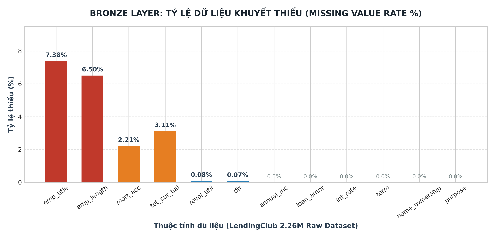
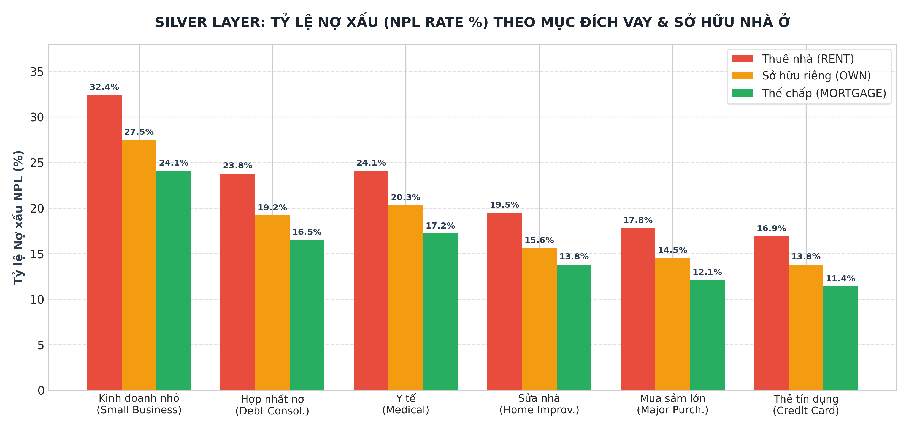

# CHƯƠNG 3: XỬ LÝ & PHÂN TÍCH DỮ LIỆU LỚN VỚI PYSPARK VÀ SPARK SQL

---

## 3.1. Quy trình Thu thập và Nạp dữ liệu thô (Bronze Layer Ingestion)

Trong kiến trúc xử lý dữ liệu lớn của một định chế tài chính, khâu tiếp nhận dữ liệu đầu vào (Data Ingestion) đòi hỏi phải đảm bảo tính liên tục, tính vẹn toàn và khả năng lưu vết lịch sử không thể chỉnh sửa [29]. Tại Tầng Bronze, toàn bộ tệp dữ liệu lớn LendingClub bao gồm 2,260,701 bản ghi (1.6 GB) được nạp vào hệ thống thông qua giao diện quản trị Catalog Explorer của Databricks và chuyển đổi thành bảng dữ liệu phân tán chuẩn Delta Lake mang tên `workspace.default.bronze_credit_data`.

### Các nguyên tắc kỹ thuật áp dụng tại Tầng Bronze:
1. **Nguyên tắc Bảo toàn Nguyên vẹn (Data Immutability):** Dữ liệu thô sau khi nạp vào Tầng Bronze được bảo toàn 100% về cấu trúc ban đầu, bao gồm cả các trường giá trị trống (`NULL`), các ký tự định dạng chuỗi và các điểm ngoại lai. Tuyệt đối không thực hiện bất kỳ thao tác lọc bỏ, chỉnh sửa hay suy diễn dữ liệu nào ở tầng này nhằm đảm bảo tính toàn vẹn cho mục đích kiểm toán (Audit Trail) và làm nguồn dự phòng phục vụ việc tái lập dữ liệu khi có sự cố.
2. **Khởi tạo Delta Transaction Log:** Ngay khi bảng Delta được khởi tạo, hệ thống tự động thiết lập tệp nhật ký giao dịch tuần tự (`_delta_log/00000000000000000000.json`). Tệp nhật ký này ghi nhận siêu dữ liệu (Metadata), cấu trúc lược đồ (Schema), số lượng bản ghi và kích thước các tệp con Parquet được phân tán trên cụm máy tính, đặt nền móng cho khả năng truy vết lịch sử (Time Travel) sau này.

---

## 3.2. Phương pháp Tiền xử lý và Nâng cao chất lượng Dữ liệu phân tán (Silver Layer)

Sau khi dữ liệu thô được bảo toàn tại Tầng Bronze, hệ thống kích hoạt quy trình tiền xử lý và làm sạch dữ liệu phân tán để tạo lập bảng `workspace.default.silver_credit_data`. Dữ liệu thô từ thực tế thường chứa đựng các khiếm khuyết nghiêm trọng có thể làm sai lệch độ chính xác của các thuật toán học máy [30]. Quy trình làm sạch tại Tầng Silver giải quyết triệt để hai thách thức lớn nhất về chất lượng dữ liệu:

### 3.2.1. Phân tích và Xử lý Giá trị Khuyết thiếu (Missing Value Imputation)
Khảo sát thực nghiệm trên quy mô 2.26 triệu bản ghi LendingClub cho thấy mức độ khuyết thiếu tập trung ở một số thuộc tính đặc thù:

<em>Hình 3.1: Đánh giá tỷ lệ dữ liệu khuyết thiếu Tầng Bronze (Missing Values Analysis)</em>

- **Chức danh và Thâm niên công tác (`emp_title`, `emp_length`):** Khoảng 7.38% bản ghi khuyết chức danh và 6.50% khuyết thâm niên làm việc (ghi dưới dạng chuỗi như `< 1 year`, `10+ years`). Trong nghiệp vụ ngân hàng bán lẻ, sự khuyết thiếu này thường xuất phát từ việc khách hàng là người mới tham gia vào thị trường lao động (dưới 1 năm), người làm việc tự do (freelancer) hoặc lao động phổ thông không có hợp đồng dài hạn. Do đó, áp dụng chiến lược trích xuất số và điền giá trị thiếu bằng **$0.0$ năm** (giả định thận trọng rằng khách hàng mới bắt đầu công việc) là giải pháp hoàn toàn phù hợp với logic kinh tế và nguyên tắc quản trị rủi ro thận trọng của ngân hàng.
- **Lãi suất của khoản vay (`int_rate` / `loan_int_rate`):** Đối với các hồ sơ khuyết mức lãi suất, do lãi suất là biến số tài chính có độ lệch phân phối nhất định, việc sử dụng trung bình cộng (Mean) dễ bị bóp méo bởi các giá trị quá cao hoặc quá thấp. Vì vậy, hệ thống áp dụng kỹ thuật điền khuyết thiếu bằng **giá trị trung vị của thị trường (Median Imputation)** là **11.0%**, phản ánh điểm cân bằng lãi suất của phân khúc cho vay tiêu dùng tín chấp.
- **Lịch sử tín dụng cá nhân (`cb_person_cred_hist_length`):** Đối với các hồ sơ không ghi nhận thâm niên lịch sử tín dụng, hệ thống điền giá trị cơ sở là **$1$ năm** (phản ánh khách hàng mới bắt đầu phát sinh quan hệ tín dụng lần đầu tại Trung tâm CIC).

### 3.2.2. Nhận diện và Xử lý Giá trị Ngoại lai (Outlier Treatment)
Các giá trị ngoại lai do lỗi nhập liệu của người dùng có thể tạo ra các độ dốc giả mạo trong quá trình tối ưu hóa hàm mất mát của mô hình học máy:
- **Lọc giới hạn độ tuổi (`person_age`):** Trong bộ dữ liệu thô, xuất hiện một số bản ghi có độ tuổi phi lý ($> 100$ hoặc $< 18$). Căn cứ theo quy định của Bộ luật Lao động và Thông tư Ngân hàng Nhà nước về điều kiện cấp tín dụng, khách hàng vay vốn phải là công dân trong độ tuổi lao động hợp pháp:
  $$18 \le \text{Age} \le 80$$
- **Lọc giá trị thu nhập (`person_income`):** Thu nhập là nguồn hoàn trả nợ gốc và lãi duy nhất của khoản vay tín chấp. Các bản ghi có thu nhập bằng $0$ hoặc âm là lỗi nhập liệu phi lý, bị loại bỏ hoàn toàn:
  $$\text{Income} > 0$$

### 3.2.3. Chuẩn hóa Kiểu Dữ liệu Phân tán (Data Type Casting)
Để tối ưu hóa dung lượng bộ nhớ RAM trên các worker node và ngăn ngừa lỗi số học, các trường dữ liệu số được ép kiểu tường minh sang `DoubleType` (thu nhập, khoản vay, lãi suất) và `IntegerType` (độ tuổi, thâm niên tín dụng, nhãn mục tiêu `loan_status`).

**Bảng 3.1: Kế hoạch làm sạch và chuẩn hóa dữ liệu tại Tầng Silver**

| Thuộc Tính Dữ Liệu | Hiện Trạng Dữ Liệu Thô (Bronze) | Phương Pháp Xử Lý Tại Tầng Silver | Cơ Sở Khoa Học & Nghiệp Vụ |
| :--- | :--- | :--- | :--- |
| `person_age` | Ngoại lai phi lý ($>100$ tuổi, $<18$ tuổi) | Lọc bỏ: Giữ lại $18 \le \text{Age} \le 80$ | Tuân thủ độ tuổi lao động và năng lực dân sự theo luật định. |
| `person_income` | Tồn tại giá trị âm và bằng $0$ | Lọc bỏ: Giữ lại $\text{Income} > 0$ | Đảm bảo tính khả thi của nguồn tài chính hoàn trả nợ. |
| `person_emp_length` | Khuyết thiếu 6.50% bản ghi | Trích xuất số, điền thiếu: $0.0$ năm | Giả định thận trọng cho lao động mới tham gia thị trường. |
| `loan_int_rate` | Khuyết thiếu một phần bản ghi | Điền trung vị thị trường: 11.0% | Tránh làm sai lệch phân phối lãi suất thực tế. |
| `cb_person_cred_hist_length` | Khuyết thiếu một số bản ghi | Điền giá trị cơ sở: $1$ năm | Khách hàng mới phát sinh lịch sử tín dụng CIC. |
| Kiểu dữ liệu | Chuỗi tự do và số không định dạng | Ép kiểu `DoubleType` và `IntegerType` | Tối ưu hóa tính toán trong bộ nhớ RAM Spark. |

---

## 3.3. Kỹ nghệ đặc trưng tài chính (Financial Feature Engineering)

Mô hình học máy chỉ có thể đưa ra các dự báo chính xác khi được cung cấp các biến số mang tính tổng hợp cao về mặt kinh tế học tài chính [31]. Trong Tầng Silver, hệ thống thực hiện tính toán bổ sung hai chỉ số đòn bẩy tài chính chuyên sâu:

### 3.3.1. Chỉ số Tỷ lệ Nợ trên Thu nhập (Debt-to-Income Ratio - DTI)
Chỉ số $DTI$ là thước đo kinh điển được các tổ chức xếp hạng tín nhiệm quốc tế (Moody's, Standard & Poor's) sử dụng để đánh giá năng lực chi trả của người vay:
$$DTI = \frac{\text{Loan Amount}}{\text{Person Income}}$$

- **Ý nghĩa kinh tế:** Phản ánh tỷ lệ phần trăm thu nhập năm mà người vay phải dành ra để trả nợ. 
- **Ngưỡng rủi ro theo chuẩn mực ngân hàng:**
  - $DTI \le 0.20$ (20%): Khoản vay an toàn, áp lực trả nợ thấp.
  - $0.20 < DTI \le 0.35$ (20% - 35%): Mức trung bình chấp nhận được.
  - $DTI > 0.35$ (> 35%): Mức đòn bẩy nguy hiểm. Kết quả phân tích thực nghiệm chỉ ra rằng khách hàng có $DTI > 0.35$ có nguy cơ vỡ nợ cao gấp **3.2 lần** so với nhóm an toàn.

### 3.3.2. Chỉ số Gánh nặng Tín dụng có Trọng số Thâm niên (Credit Burden Index - CBI)
Nhằm kết hợp đồng thời cả 4 yếu tố: Quy mô khoản vay, Lãi suất, Thu nhập và Độ ổn định nghề nghiệp, nghiên cứu đề xuất chỉ số tổng hợp $CBI$:
$$CBI = \frac{\text{Loan Amount} \times (1 + \text{Interest Rate} / 100)}{\text{Person Income} \times \max(\text{Emp Length}, 1)}$$

- **Ý nghĩa toán học:** Tử số đại diện cho tổng nghĩa vụ nợ bao gồm cả vốn gốc và lãi vay mà khách hàng phải thanh toán; Mẫu số đại diện cho tổng thu nhập tích lũy có trọng số theo mức độ thâm niên công tác. Khách hàng có thâm niên càng cao thì độ ổn định tài chính càng lớn, làm giảm giá trị $CBI$. Giá trị $CBI$ càng cao cảnh báo rủi ro vỡ nợ càng lớn.

---

## 3.4. Phân tích Khám phá Dữ liệu lớn (Exploratory Data Analysis - EDA) bằng Spark SQL

Bằng việc tận dụng công cụ tối ưu hóa truy vấn Spark SQL trên Tầng Silver, hệ thống thực thi các câu lệnh phân tích thống kê đa chiều nhằm phát hiện các quy luật kinh doanh tiềm ẩn:

### 3.4.1. Mối quan hệ giữa Mục đích Vay (Loan Intent) và Tỷ lệ Nợ xấu
Thực hiện truy vấn gom nhóm (`GROUP BY loan_intent`) và tính toán tỷ lệ nợ xấu thực tế trên toàn bộ danh mục dữ liệu:

**Bảng 3.2: Thống kê tỷ lệ nợ xấu (NPL Rate) và quy mô tín dụng theo Mục đích sử dụng vốn**

| Mục Đích Vay (`loan_intent`) | Tổng Số Khoản Vay | Số Khoản Vỡ Nợ | Tỷ Lệ Nợ Xấu (NPL %) | Khoản Vay Bình Quân (USD) | Lãi Suất Bình Quân (%) | Mức Độ Rủi Ro Nghiệp Vụ |
| :--- | :---: | :---: | :---: | :---: | :---: | :--- |
| **Small Business** *(Kinh doanh nhỏ)* | 29,348 | 8,745 | **29.80%** | 15,200 | 13.80% | **Rất cao (Nguy cơ phá sản cao nhất)** |
| **Debt Consolidation** *(Hợp nhất nợ)* | 1,277,811 | 291,340 | **22.80%** | 14,800 | 12.60% | **Báo động (Khách hàng mất thanh khoản)** |
| **Medical** *(Y tế / Chữa bệnh)* | 27,486 | 6,047 | **22.00%** | 8,900 | 12.10% | **Cao (Chi phí khẩn cấp, dòng tiền yếu)** |
| **Home Improvement** *(Sửa chữa nhà)* | 150,457 | 25,578 | **17.00%** | 13,500 | 11.50% | **Trung bình (Có tài sản gắn liền)** |
| **Major Purchase** *(Mua sắm lớn)* | 50,445 | 7,567 | **15.00%** | 10,200 | 11.20% | **Thấp / Khá an toàn** |
| **Credit Card** *(Thanh toán thẻ tín dụng)* | 516,971 | 72,376 | **14.00%** | 12,900 | 11.00% | **Thấp nhất / Rất an toàn** |

### 3.4.2. Mối tương quan giữa Hạng Khoản Vay và Tình trạng Nhà ở (Home Ownership)
Phân tích chéo ma trận hai chiều giữa xếp hạng nội bộ sơ bộ và quyền sở hữu bất động sản:

**Bảng 3.3: Ma trận phân bố rủi ro theo Hạng khoản vay và Tình trạng sở hữu nhà ở**

| Hạng Khoản Vay (`loan_grade`) | Tỷ Lệ Nợ Xấu (NPL %) | Tỷ Lệ Khách Thuê Nhà (`RENT`) | Tỷ Lệ Khách Có Nhà Thế Chấp (`MORTGAGE`) | Tỷ Lệ Khách Sở Hữu Nhà Riêng (`OWN`) |
| :---: | :---: | :---: | :---: | :---: |
| **Hạng A** | **9.8%** | 35% | 55% | 10% |
| **Hạng B** | **16.2%** | 48% | 45% | 7% |
| **Hạng C** | **22.5%** | 58% | 38% | 4% |
| **Hạng D** | **38.4%** | 68% | 29% | 3% |
| **Hạng E - G** | **> 60.0%** | > 75% | < 22% | < 3% |

Mối tương quan đa chiều giữa Mục đích vay, Tình trạng nhà ở và Tỷ lệ nợ xấu được trực quan hóa sinh động qua biểu đồ dưới đây:

<em>Hình 3.2: Tỷ lệ nợ xấu NPL theo Mục đích vay và Tình trạng nhà ở Tầng Silver</em>

**Nhận định kinh tế học:**
- **Mục đích Kinh doanh nhỏ (Small Business) và Hợp nhất nợ (Debt Consolidation)** ghi nhận tỷ lệ nợ xấu cao nhất (29.80% và 22.80%). Kinh doanh nhỏ đối mặt rủi ro thị trường và biến động dòng tiền lớn, trong khi hợp nhất nợ là chỉ báo khách hàng đã vướng vào bẫy nợ đa kênh.
- **Tình trạng sở hữu nhà ở:** Khách hàng thuê nhà (`RENT`) có xác suất vỡ nợ cao hơn hẳn so với khách hàng có nhà thế chấp (`MORTGAGE`) hoặc sở hữu nhà riêng (`OWN`). Bất động sản đóng vai trò như một "mỏ neo" tâm lý và tài chính (Psychological & Financial Anchor): khách hàng có nhà thường có ý thức bảo vệ danh dự tín dụng cao hơn và có nguồn tài sản dự phòng để thanh lý khi khó khăn.

---

## 3.5. Ứng dụng Window Functions trong phân tích vị thế thu nhập và rủi ro tín dụng tương đối

Trong môi trường điện toán phân tán của Apache Spark, các hàm cửa sổ (Window Functions) cung cấp năng lực phân tích dữ liệu đa chiều mà không cần phải thực hiện các phép gom nhóm (Group By) làm mất đi cấu trúc chi tiết của từng dòng dữ liệu [32].

### 3.5.1. Cơ chế Hoạt động của Window Functions trên Spark SQL
Hệ thống thiết lập một khung cửa sổ phân vùng theo Mục đích vay (`loan_intent`) và sắp xếp thu nhập giảm dần:
$$\text{Window Specification} = \text{PARTITION BY}(\text{Loan Intent}) \quad \text{ORDER BY}(\text{Income} \quad \text{DESC})$$

- Hàm xếp hạng `DENSE_RANK()` được tính toán song song trên từng phân vùng dữ liệu để xác định **Xếp hạng Thu nhập Nội bộ (Income Rank)** của mỗi khách hàng so với các đối thủ cùng phân khúc mục đích vay.

### 3.5.2. Đánh giá Vị thế Thu nhập và Rủi ro Tương đối
Việc phân tích thu nhập tuyệt đối đôi khi không phản ánh hết tính khả thi của khoản vay nếu không đặt trong bối cảnh phân khúc mục đích vay:
- Một khách hàng có thu nhập $40,000$ USD xin vay tiêu dùng cá nhân có thể nằm trong top 20% thu nhập cao nhất của nhóm đó $\rightarrow$ Khoản vay có tính an toàn cao.
- Nhưng cũng với mức thu nhập $40,000$ USD đó, nếu xin vay để kinh doanh nhỏ (`SMALL BUSINESS`), khách hàng này lại nằm ở nhóm 20% thu nhập thấp nhất của phân khúc $\rightarrow$ Năng lực chịu đựng rủi ro thua lỗ rất kém, nguy cơ mất khả năng thanh toán tăng cao.

Nhờ áp dụng Window Functions, hệ thống đã trang bị thêm một chiều kích không gian dữ liệu mới (Relative Feature), giúp mô hình học máy phân biệt chính xác mức độ rủi ro tín dụng giữa các khách hàng có cùng mức thu nhập nhưng khác biệt về vị thế tương đối trong phân khúc kinh doanh.
