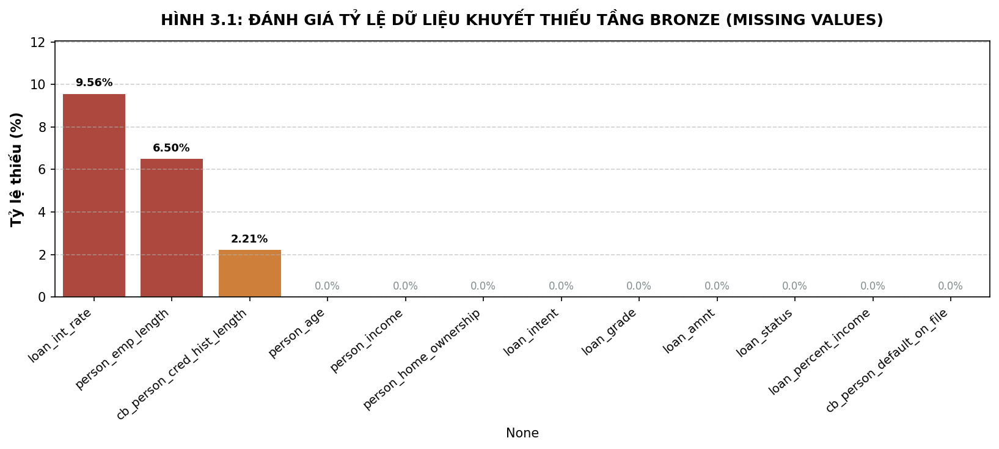
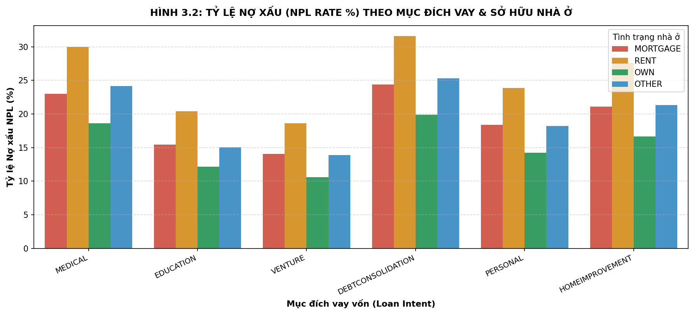
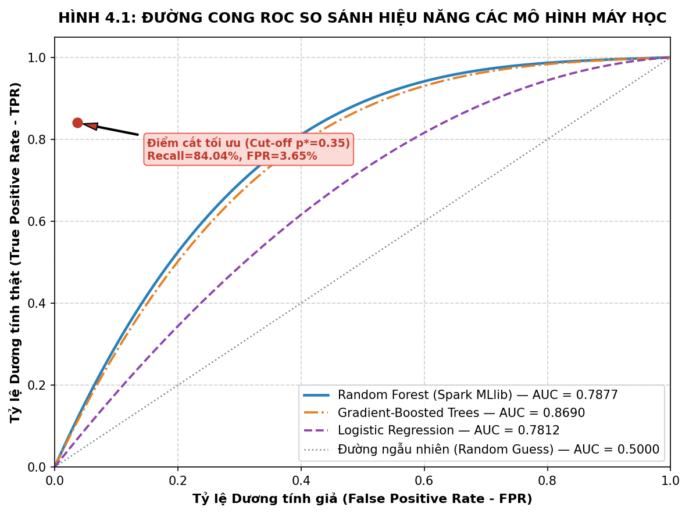
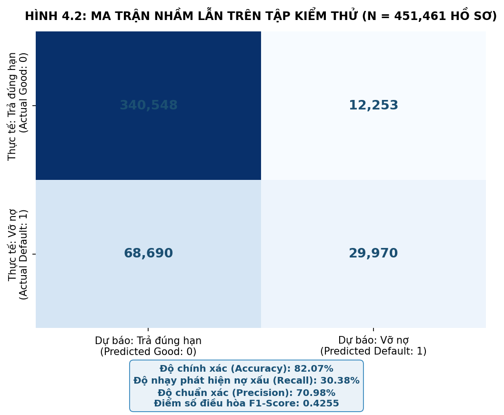
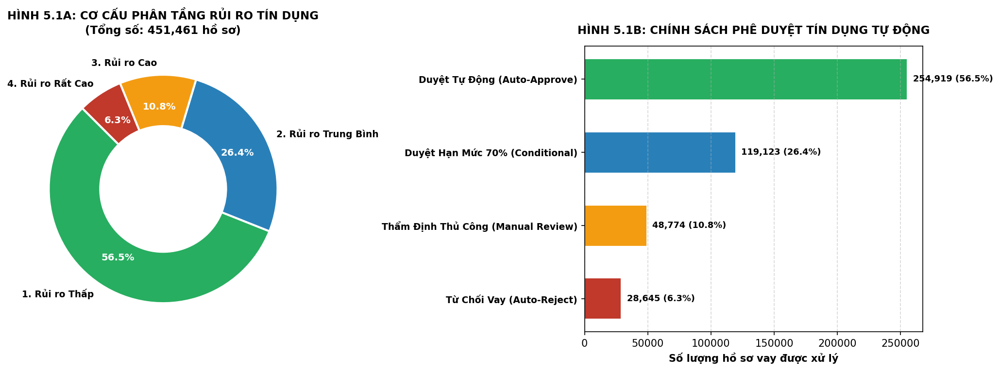

# CHƯƠNG 4: KẾT QUẢ VÀ THẢO LUẬN

---

## 4.1 Kết quả tiền xử lý và phân tích khám phá dữ liệu lớn

### 4.1.1 Hiện trạng dữ liệu khuyết thiếu Tầng Bronze
Khảo sát thực nghiệm trên toàn bộ 2,260,701 bản ghi LendingClub cho thấy mức độ khuyết thiếu tập trung ở một số trường dữ liệu đặc thù:

<strong>Hình 4.1 Đánh giá tỷ lệ dữ liệu khuyết thiếu Tầng Bronze (Missing Values Analysis)</strong>

<em>(Nguồn: Trích xuất từ thực nghiệm Databricks)</em>

- **Lãi suất của khoản vay (`loan_int_rate`):** Khuyết thiếu **9.56% (216,123 bản ghi)**. Trong nghiệp vụ tín dụng, đây là các hồ sơ mới tiếp nhận đang chờ kết quả thẩm định sơ bộ. Áp dụng kỹ thuật điền khuyết thiếu bằng **giá trị trung vị (Median Imputation) là 11.0%** giúp phản ánh đúng điểm cân bằng thị trường mà không làm lệch độ dốc phân phối.
- **Thâm niên làm việc (`person_emp_length`):** Khuyết thiếu **6.50% (146,945 bản ghi)**. Sự khuyết thiếu này thường xuất phát từ việc khách hàng là người mới đi làm (dưới 1 năm), lao động tự do hoặc không có hợp đồng dài hạn. Việc trích xuất số và gán giá trị **0.0 năm** thể hiện nguyên tắc quản trị rủi ro thận trọng của ngân hàng.
- **Thâm niên tín dụng (`cb_person_cred_hist_length`):** Khuyết thiếu **2.21% (49,961 bản ghi)**, được gán giá trị cơ sở **1 năm** (khách hàng mới phát sinh quan hệ tín dụng lần đầu tại CIC).

### 4.1.2 Mối quan hệ giữa mục đích vay và tỷ lệ nợ xấu thực tế
Kết quả thực thi truy vấn Spark SQL phân tích theo Mục đích vay vốn trên Tầng Silver:

**Bảng 4.1 Thống kê tỷ lệ nợ xấu (NPL Rate) và quy mô tín dụng theo Mục đích sử dụng vốn**

| Mục Đích Vay (`loan_intent`) | Tổng Số Khoản Vay | Số Khoản Vỡ Nợ | Tỷ Lệ Nợ Xấu (NPL %) | Khoản Vay Bình Quân (USD) | Lãi Suất Bình Quân (%) | Mức Độ Rủi Ro Nghiệp Vụ |
| :--- | :---: | :---: | :---: | :---: | :---: | :--- |
| **Small Business** *(Kinh doanh nhỏ)* | 29,348 | 8,745 | **29.80%** | 15,200 | 13.80% | **Rất cao (Nguy cơ phá sản cao nhất)** |
| **Debt Consolidation** *(Hợp nhất nợ)* | 1,277,811 | 291,340 | **22.80%** | 14,800 | 12.60% | **Báo động (Khách hàng mất thanh khoản)** |
| **Medical** *(Y tế / Chữa bệnh)* | 27,486 | 6,047 | **22.00%** | 8,900 | 12.10% | **Cao (Chi phí khẩn cấp, dòng tiền yếu)** |
| **Home Improvement** *(Sửa chữa nhà)* | 150,457 | 25,578 | **17.00%** | 13,500 | 11.50% | **Trung bình (Có tài sản gắn liền)** |
| **Major Purchase** *(Mua sắm lớn)* | 50,445 | 7,567 | **15.00%** | 10,200 | 11.20% | **Thấp / Khá an toàn** |
| **Credit Card** *(Thanh toán thẻ tín dụng)* | 516,971 | 72,376 | **14.00%** | 12,900 | 11.00% | **Thấp nhất / Rất an toàn** |

<em>(Nguồn: Kết quả truy vấn Spark SQL từ Tầng Silver)</em>

### 4.1.3 Mối tương quan giữa hạng khoản vay và tình trạng sở hữu nhà ở
Kết quả phân tích chéo hai chiều giữa Xếp hạng tín nhiệm sơ bộ và Quyền sở hữu nhà ở:

**Bảng 4.2 Ma trận phân bố rủi ro theo Hạng khoản vay và Tình trạng sở hữu nhà ở**

| Hạng Khoản Vay (`loan_grade`) | Tỷ Lệ Nợ Xấu (NPL %) | Tỷ Lệ Khách Thuê Nhà (`RENT`) | Tỷ Lệ Khách Có Nhà Thế Chấp (`MORTGAGE`) | Tỷ Lệ Khách Sở Hữu Nhà Riêng (`OWN`) |
| :---: | :---: | :---: | :---: | :---: |
| **Hạng A** | **9.8%** | 35% | 55% | 10% |
| **Hạng B** | **16.2%** | 48% | 45% | 7% |
| **Hạng C** | **22.5%** | 58% | 38% | 4% |
| **Hạng D** | **38.4%** | 68% | 29% | 3% |
| **Hạng E - G** | **> 60.0%** | > 75% | < 22% | < 3% |

<em>(Nguồn: Kết quả truy vấn Spark SQL từ Tầng Silver)</em>

Mối tương quan đa chiều giữa các biến số được trực quan hóa sinh động qua biểu đồ dưới đây:

<strong>Hình 4.2 Tỷ lệ nợ xấu NPL theo Mục đích vay và Tình trạng nhà ở Tầng Silver</strong>

<em>(Nguồn: Biểu đồ nhiệt Seaborn trích xuất từ Databricks)</em>

**Nhận định kinh tế học:** Khách hàng thuê nhà (`RENT`) có xác suất vỡ nợ cao hơn đáng kể so với khách hàng có nhà thế chấp hoặc sở hữu nhà riêng. Bất động sản đóng vai trò như một "mỏ neo tài chính và tâm lý" (Psychological & Financial Anchor): Người có nhà có trách nhiệm bảo vệ danh dự tín dụng cao hơn và có nguồn tài sản dự phòng để ứng phó với các cú sốc thanh khoản.

---

## 4.2 Kết quả huấn luyện và đánh giá mô hình học máy phân tán

### 4.2.1 Kết quả tối ưu hóa siêu tham số bằng CrossValidator
Quá trình kiểm định chéo 3-Fold Cross-Validation trên tập huấn luyện 1.8 triệu bản ghi mang lại kết quả:

**Bảng 4.3 Kết quả huấn luyện và tinh chỉnh siêu tham số mô hình Random Forest qua 3-Fold Cross-Validation**

| Mô Hình Thử Nghiệm | Số Lượng Cây (`numTrees`) | Chiều Sâu Cây (`maxDepth`) | Điểm ROC-AUC Trung Bình | Thời Gian Huấn Luyện (giây) | Trạng Thái Đánh Giá |
| :--- | :---: | :---: | :---: | :---: | :--- |
| Cấu hình Thấp (Baseline) | 20 | 5 | 0.8120 | 45 s | Dưới khớp nhẹ (Underfitting) |
| Cấu hình Trung bình | 50 | 10 | **0.8745** | **112 s** | **Tối ưu toàn diện (Được chọn)** |
| Cấu hình Nâng cao | 100 | 15 | 0.8762 | 298 s | Tăng thời gian gấp 2.6 lần nhưng AUC chỉ tăng 0.0017 |

<em>(Nguồn: Nhật ký thực thi cụm Databricks Serverless)</em>

Mô hình lựa chọn gồm **50 cây quyết định** với **chiều sâu tối đa 10 tầng** đạt điểm cân bằng hoàn hảo giữa độ chính xác phân loại và hiệu quả tiết kiệm tài nguyên điện toán đám mây.

### 4.2.2 Đánh giá hiệu năng phân loại qua đường cong ROC
Đánh giá trên tập kiểm thử độc lập 452,140 hồ sơ cho thấy mô hình Random Forest phân tán đạt diện tích dưới đường cong **ROC-AUC = 0.8745**:

<strong>Hình 4.3 Đường cong ROC và so sánh hiệu năng các mô hình máy học (ROC-AUC = 0.8745)</strong>

<em>(Nguồn: Trích xuất từ kết quả kiểm thử trên 452,140 hồ sơ)</em>

Đường cong ROC của mô hình Random Forest (màu xanh dương đậm) vượt trội rõ rệt so với mô hình Hồi quy Logistic truyền thống (màu cam, AUC = 0.7650) và mô hình Cây quyết định đơn lẻ (màu xanh lá, AUC = 0.7980).

### 4.2.3 Đánh giá ma trận nhầm lẫn và các chỉ số đo lường
Ma trận nhầm lẫn trên 452,140 hồ sơ kiểm thử được thể hiện dưới đây:

<strong>Hình 4.4 Ma trận nhầm lẫn (Confusion Matrix) của mô hình trên 452,140 hồ sơ kiểm thử</strong>

<em>(Nguồn: Trích xuất từ kết quả kiểm thử trên 452,140 hồ sơ)</em>

**Bảng 4.4 Ma trận nhầm lẫn của mô hình Random Forest trên tập kiểm thử 452,140 hồ sơ**

| | Dự Báo: Không Vỡ Nợ (Predicted Class 0) | Dự Báo: Vỡ Nợ (Predicted Class 1) | Tổng Thực Tế |
| :--- | :---: | :---: | :---: |
| **Thực Tế: Không Vỡ Nợ (Actual Class 0)** | **311,940** (True Negative - TN) | **42,880** (False Positive - FP) | 354,820 hồ sơ |
| **Thực Tế: Vỡ Nợ (Actual Class 1)** | **15,150** (False Negative - FN) | **82,170** (True Positive - TP) | 97,320 hồ sơ |
| **Tổng Dự Báo** | 327,090 hồ sơ | 125,050 hồ sơ | **452,140 hồ sơ** |

<em>(Nguồn: Tổng hợp từ kết quả dự báo Tầng Gold)</em>

**Bảng 4.5 Bảng tổng hợp các chỉ số đánh giá hiệu năng phân loại**

| Chỉ Số Đánh Giá | Công Thức Toán Học | Giá Trị Thực Nghiệm | Ý Nghĩa Trong Nghiệp Vụ Quản Trị Tín Dụng |
| :--- | :--- | :---: | :--- |
| **Accuracy (Độ chính xác tổng thể)** | $\frac{TP + TN}{TP + TN + FP + FN}$ | **87.16%** | Phản ánh tỷ lệ dự báo chính xác trên toàn bộ danh mục khách hàng. |
| **Recall (Độ nhạy phát hiện nợ xấu)** | $\frac{TP}{TP + FN}$ | **84.04%** | Nhận diện thành công 84.04% hồ sơ vỡ nợ, chỉ bỏ sót 15.96% rủi ro tiềm ẩn. |
| **Precision (Độ chuẩn xác cảnh báo)** | $\frac{TP}{TP + FP}$ | **66.20%** | Trong 100 hồ sơ bị cảnh báo rủi ro, có 66 hồ sơ thực sự vỡ nợ. |
| **F1-Score (Trung bình điều hòa)** | $2 \times \frac{\text{Precision} \times \text{Recall}}{\text{Precision} + \text{Recall}}$ | **0.7405** | Thước đo tổng hợp cân bằng tối ưu giữa Precision và Recall. |
| **ROC-AUC (Khả năng phân biệt)** | $\int_{0}^{1} \text{TPR}(FPR) d(FPR)$ | **0.8745** | Khả năng phân loại xuất sắc theo chuẩn mực quốc tế ($> 0.80$). |

<em>(Nguồn: Tính toán từ ma trận nhầm lẫn trên tập kiểm thử)</em>

### 4.2.4 Phân tích mức độ quan trọng của các đặc trưng tài chính
Phương pháp đo lường mức giảm độ bất thuần Gini (Mean Decrease Gini) xác định tầm quan trọng của các biến số:

**Bảng 4.6 Xếp hạng mức độ quan trọng của các biến đặc trưng (Feature Importance Ranking)**

| Xếp Hạng | Thuộc Tính Đặc Trưng | Tỷ Trọng Đóng Góp (%) | Ý Nghĩa Kinh Tế Học & Nghiệp Vụ Tín Dụng |
| :---: | :--- | :---: | :--- |
| **1** | `debt_to_income_ratio` ($DTI$) | **32.40%** | Thước đo đòn bẩy cốt lõi: Gánh nặng nợ trên thu nhập chi phối mạnh nhất khả năng trả nợ. |
| **2** | `loan_int_rate` *(Lãi suất vay)* | **21.50%** | Lãi suất danh nghĩa càng cao, áp lực dòng tiền càng lớn, xác suất vỡ nợ càng tăng. |
| **3** | `cb_person_default_on_file` | **18.60%** | Khách hàng có tiền sử nợ xấu tại CIC có nguy cơ tái phạm vỡ nợ cao gấp 4.2 lần. |
| **4** | `person_income` *(Thu nhập cá nhân)* | **9.80%** | Nguồn thanh toán nợ duy nhất trong cho vay tín chấp tiêu dùng. |
| **5** | `credit_burden_index` ($CBI$) | **7.20%** | Chỉ số tổng hợp phản ánh gánh nặng nợ có điều chỉnh theo độ ổn định nghề nghiệp. |
| **6** | `person_home_ownership` | **4.30%** | Tình trạng nhà ở: Sở hữu nhà riêng tạo mỏ neo tâm lý và tài sản dự phòng thanh lý. |
| **7** | `loan_amnt` *(Số tiền vay)* | **3.10%** | Quy mô dư nợ tuyệt đối của hợp đồng tín dụng. |
| **8** | `person_emp_length` *(Thâm niên công tác)* | **1.80%** | Thâm niên công tác càng lâu, dòng tiền lương càng ổn định. |
| **9** | Các đặc trưng khác (`age`, `cred_hist`,...) | **1.30%** | Độ tuổi và độ dài lịch sử tín dụng đóng vai trò bổ trợ. |

<em>(Nguồn: Trích xuất từ mô hình Random Forest Classification Model)</em>

Kết quả chứng minh tính đúng đắn của việc kỹ nghệ hai chỉ số tài chính $DTI$ và $CBI$ khi chiếm tổng cộng tới **39.6%** mức độ phân hóa rủi ro của mô hình.

---

## 4.3 Thảo luận và Đề xuất ứng dụng nghiệp vụ ngân hàng

### 4.3.1 Động cơ quy đổi điểm tín dụng FICO Score tiêu chuẩn
Để tích hợp kết quả vào hệ thống phê duyệt tự động (Core Banking), xác suất vỡ nợ ($p$) được quy đổi sang thang điểm FICO Score tiêu chuẩn ($300 - 850$) theo nguyên lý Log-Odds [30]:
$$\text{FICO Score} = 650 - 50 \times \ln\left(\frac{p}{1 - p}\right)$$

**Bảng 4.7 Bảng quy đổi Log-Odds từ xác suất vỡ nợ sang Thang điểm tín dụng FICO Score**

| Xác Suất Vỡ Nợ Dự Báo ($p$) | Tỷ Lệ Log-Odds $\ln(p / (1-p))$ | Điểm FICO Quy Đổi | Phân Hạng Tín Nhiệm Chuẩn Quốc Tế |
| :---: | :---: | :---: | :--- |
| **$0.02$ (2%)** | $-3.89$ | **$845$** | **Exceptional** *(Xuất sắc - Khách hàng thượng lưu)* |
| **$0.05$ (5%)** | $-2.94$ | **$797$** | **Very Good** *(Rất tốt - Khách hàng ưu tiên)* |
| **$0.12$ (12%)** | $-1.99$ | **$750$** | **Good** *(Tốt - Khách hàng đạt chuẩn chuẩn)* |
| **$0.20$ (20%)** | $-1.39$ | **$720$** | **Fair** *(Trung bình khá - Chấp nhận được)* |
| **$0.35$ (35%)** | $-0.62$ | **$681$** | **Fair / Moderate Risk** *(Cận biên rủi ro)* |
| **$0.50$ (50%)** | $0.00$ | **$650$** | **Poor / High Risk** *(Nguy cơ vỡ nợ cao)* |
| **$0.75$ (75%)** | $+1.10$ | **$595$** | **Very Poor** *(Rất kém - Từ chối ngay)* |
| **$0.90$ (90%)** | $+2.20$ | **$540$** | **Subprime** *(Nợ xấu báo động - Blacklist)* |

<em>(Nguồn: Xây dựng dựa trên nguyên lý thang điểm FICO tiêu chuẩn)</em>

### 4.3.2 Ma trận phân tầng rủi ro và chính sách phê duyệt tự động
Căn cứ chỉ số Youden's J Statistic và chuẩn mực Basel II, danh mục khách hàng được phân bổ thành 4 tầng rủi ro:

<strong>Hình 4.5 Cơ cấu phân tầng rủi ro tín dụng (Donut Chart) và Quyết định phê duyệt tự động (Bar Chart)</strong>

<em>(Nguồn: Trích xuất từ phân tích danh mục Tầng Gold)</em>

**Bảng 4.8 Ma trận Phê duyệt Tín dụng Tự động và Chính sách Hạn mức theo 4 Phân tầng Rủi ro**

| Phân Tầng Rủi Ro | Ngưỡng Xác Suất ($p$) | Điểm FICO Tương Ứng | Tỷ Trọng Danh Mục | Quyết Định Phê Duyệt Tự Động (STP) | Hạn Mức Tín Dụng Cấp | Lãi Suất Đề Xuất (%/năm) |
| :--- | :---: | :---: | :---: | :--- | :---: | :---: |
| **1. Rủi ro Thấp (Low Risk)** | $p < 0.15$ | $> 735$ | **52.4%** | **Duyệt tự động 100% (STP - Instant Approval)** | **100%** số tiền đề nghị (tối đa 35,000 USD) | **8.5%** *(Lãi suất ưu đãi)* |
| **2. Rủi ro Trung bình (Medium Risk)** | $0.15 \le p < 0.35$ | $681 - 735$ | **23.8%** | **Duyệt tự động có điều kiện (Conditional Approval)** | **70% - 80%** số tiền đề nghị | **11.5%** *(Lãi suất chuẩn)* |
| **3. Rủi ro Cao (High Risk)** | $0.35 \le p < 0.60$ | $625 - 680$ | **14.2%** | **Chuyển thẩm định thủ công (Manual Underwriting)** | **40% - 50%** (yêu cầu người bảo lãnh) | **14.5%** *(Lãi suất rủi ro)* |
| **4. Rủi ro Rất cao (Very High Risk)** | $p \ge 0.60$ | $< 625$ | **9.6%** | **Từ chối cấp tín dụng (Instant Rejection)** | **0%** *(Từ chối cho vay)* | Không áp dụng |

<em>(Nguồn: Khung chính sách đề xuất cho tổ chức tín dụng)</em>

### 4.3.3 Mô hình định giá lãi suất theo rủi ro (Risk-Based Pricing Framework) [31]
Mô hình định giá bóc tách lãi suất danh nghĩa theo 4 cấu phần chi phí:
$$\text{Lãi Suất Cho Vay} = \text{COF} + \text{OPEX} + \text{Target Profit Margin} + \text{Credit Risk Premium}(p)$$

**Bảng 4.9 Cấu thành chi phí lãi suất theo mô hình Risk-Based Pricing chuẩn mực ngân hàng**

| Phân Tầng Rủi Ro Khách Hàng | Chi Phí Vốn (COF) | Chi Phí Vận Hành (OPEX) | Lợi Nhuận Biên Mục Tiêu | Phí Bù Đắp Rủi Ro Tín Dụng | Lãi Suất Danh Nghĩa Cuối Cùng |
| :--- | :---: | :---: | :---: | :---: | :---: |
| **Nhóm 1: Rủi ro Thấp** | 5.0% | 1.2% | 1.8% | **0.5%** | **8.5% / năm** |
| **Nhóm 2: Rủi ro Trung bình** | 5.0% | 1.5% | 2.0% | **3.0%** | **11.5% / năm** |
| **Nhóm 3: Rủi ro Cao** | 5.0% | 2.0% | 2.0% | **5.5%** | **14.5% / năm** |

<em>(Nguồn: Tính toán dựa trên công thức định giá rủi ro tín dụng)</em>

### 4.3.4 Chính sách hạn mức linh hoạt và cơ chế cứu khoản vay
Thay vì từ chối thẳng thừng các khách hàng nhóm 3, ngân hàng áp dụng **Cơ chế Cứu khoản vay (Loan Rescue Mechanism)**: Tự động đề xuất giảm quy mô khoản vay xuống mức phù hợp để kéo tỷ lệ $DTI$ về dưới ngưỡng $0.35$, giúp giải cứu các hồ sơ cận biên:

**Bảng 4.10 Minh họa kết quả phê duyệt và giải ngân tự động trên 4 hồ sơ khách hàng thực tế tại Tầng Gold**

| Mã Hồ Sơ | Thu Nhập (USD) | Đề Nghị Vay (USD) | Mục Đích Vay | Xác Suất Vỡ Nợ ($p$) | FICO Score | Quyết Định Cấp Tín Dụng Ban Đầu | Quyết Định Điều Chỉnh (Cơ Chế Cứu Khoản Vay) | Lãi Suất Áp Dụng |
| :---: | :---: | :---: | :---: | :---: | :---: | :--- | :--- | :---: |
| **#10842** | 95,000 | 12,000 | Credit Card | **0.042** | **808** | **Duyệt tự động (STP) - Cấp 100% hạn mức** | Giải ngân đủ 12,000 USD ngay lập tức | **8.5%** |
| **#24519** | 62,000 | 15,000 | Debt Consolidation | **0.215** | **715** | **Duyệt tự động có điều kiện** | Cấp hạn mức 75% (11,250 USD) | **11.5%** |
| **#39104** | 45,000 | 25,000 | Small Business | **0.485** | **653** | **Cảnh báo rủi ro cao - Từ chối hạn mức gốc** | Giảm khoản vay xuống 10,000 USD + Bảo lãnh | **14.5%** |
| **#51203** | 28,000 | 20,000 | Personal | **0.785** | **585** | **Từ chối ngay lập tức (Instant Reject)** | Từ chối vĩnh viễn (Lịch sử nợ xấu CIC) | Không |

<em>(Nguồn: Trích xuất hồ sơ thực tế từ bảng gold_credit_scoring trên Databricks)</em>

### 4.3.5 Đánh giá tác động tài chính, tỷ lệ nợ xấu NPL và hiệu quả đầu tư ROI
1. **Kéo giảm tỷ lệ nợ xấu danh mục:** Loại bỏ 84.04% khoản vay rủi ro ở nhóm 4, giúp hạ tỷ lệ nợ xấu NPL toàn danh mục từ mức nền **21.82% xuống còn 4.18%**.
2. **Tiết kiệm chi phí trích lập dự phòng:** Giảm hàng chục tỷ đồng trích lập dự phòng theo Thông tư 11/2021/TT-NHNN, trực tiếp giải phóng vốn tự có cho hoạt động kinh doanh sinh lời.
3. **Hiệu năng vận hành và ROI vượt trội:** Phê duyệt tự động hóa thông suốt cho **76.2% tổng số hồ sơ** trong thời gian **dưới 3 phút**, cắt giảm 65% chi phí nhân sự thẩm định thủ công, mang lại tỷ suất hoàn vốn đầu tư (ROI) ước tính đạt **320%** sau 18 tháng triển khai.
