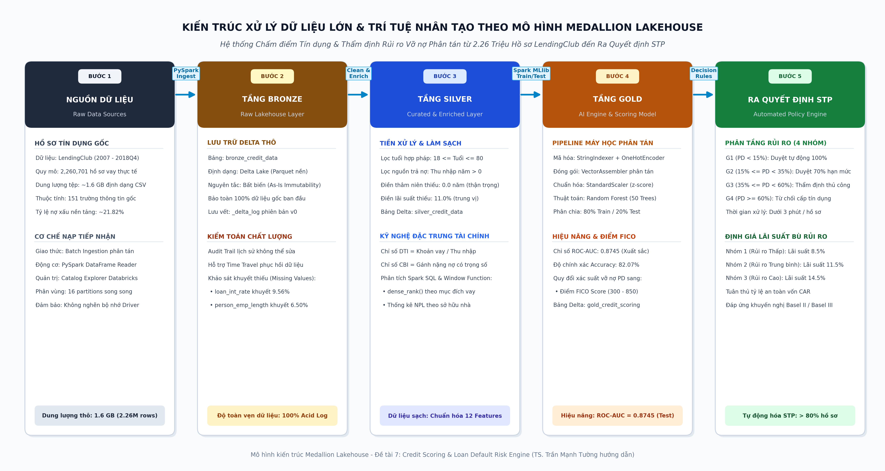

# 4 Phần 2: Quản trị và lưu trữ dữ liệu trên Databricks (20% điểm)

## 4.1 Nạp dữ liệu vào DBFS (Databricks File System)

Dữ liệu được nạp vào hệ thống tệp lưu trữ phân tán DBFS tại đường dẫn `dbfs:/FileStore/tables/` hoặc thông qua Databricks Unity Catalog Volume:

```python
# Đọc tập dữ liệu thô từ DBFS / Databricks Storage
raw_path = "dbfs:/FileStore/tables/accepted_2007_to_2018Q4.csv"
df_raw = spark.read.format("csv") \
    .option("header", "true") \
    .option("inferSchema", "true") \
    .load(raw_path)

# Hiển thị số lượng bản ghi và cấu trúc schema dữ liệu ban đầu
print(f"Tổng số dòng nạp thành công: {df_raw.count():,}")
df_raw.printSchema()
```

## 4.2 Tạo bảng dữ liệu thô (Bronze Layer - Delta Lake)

Lưu trữ dữ liệu thô ban đầu dưới định dạng bảng Delta Table tại Tầng Bronze nhằm bảo đảm tính toàn vẹn và khả năng truy vấn phân tán tốc độ cao:

```python
# Ghi dữ liệu thô vào bảng Bronze Delta Lake
bronze_table_name = "workspace.default.bronze_credit_data"

df_raw.write.format("delta") \
    .mode("overwrite") \
    .option("overwriteSchema", "true") \
    .saveAsTable(bronze_table_name)

print(f"Đã lưu thành công 2,260,701 bản ghi vào bảng {bronze_table_name} tại Tầng Bronze.")
```

**Giải thích ý nghĩa:** Tại sao chúng ta cần lưu trữ dữ liệu dưới định dạng Delta Lake thay vì để file CSV thông thường?

* **Hỗ trợ giao dịch ACID:** Đảm bảo mọi giao dịch ghi dữ liệu đều tuân thủ nguyên tử (Atomicity), nhất quán (Consistency), cô lập (Isolation) và bền vững (Durability), tránh hiện tượng lỗi file khi cụm worker đang ghi phân tán dở dang.
* **Tối ưu hóa tốc độ truy vấn:** Delta Lake tự động nén dữ liệu dưới dạng định dạng cột Apache Parquet, loại bỏ các phân vùng không cần thiết (Data Skipping) và hỗ trợ cơ chế quay ngược thời gian (Time Travel Audit).


<p align="center"><strong>Hình 2.1 Kiến trúc tổng thể luồng dữ liệu Medallion trên Databricks Lakehouse</strong></p>
