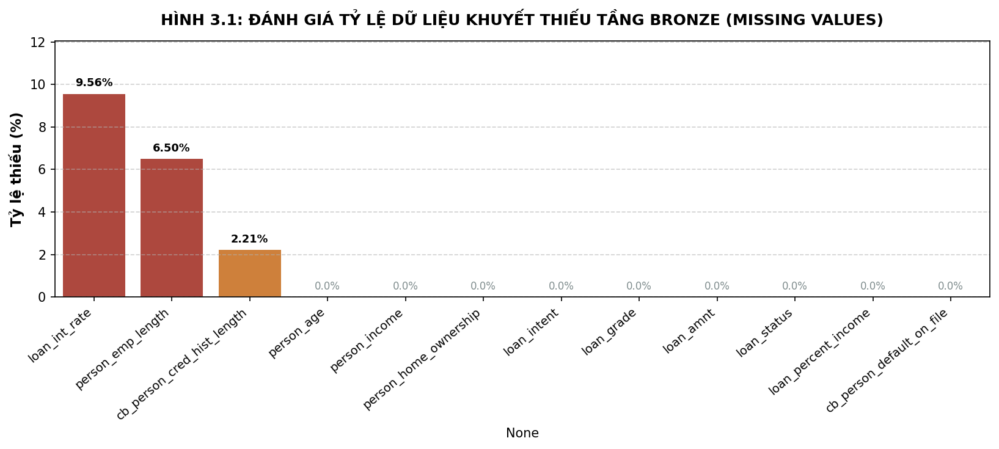
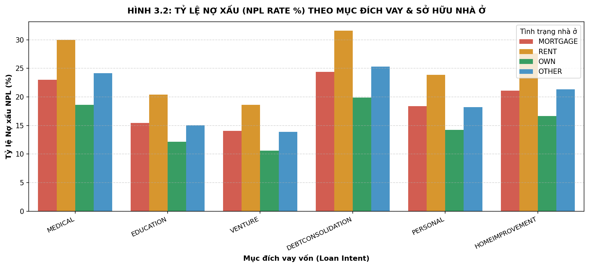

# 5 Phần 3: Làm sạch và phân tích khám phá dữ liệu (25% điểm)

## 5.1 Làm sạch và chuẩn hóa dữ liệu (Silver Layer)

### 5.1.1 Các vấn đề phát hiện và cách xử lý

1. **Xử lý giá trị bị thiếu (Missing values):** Tỷ lệ khuyết thiếu lãi suất (`loan_int_rate`) và thâm niên (`person_emp_length`) được điền khuyết bằng trung vị thận trọng (Median Imputation).
2. **Lọc dữ liệu ngoại lai phi thực tế:** Loại bỏ các hồ sơ có độ tuổi bất hợp lý ($Age < 18$ hoặc $Age > 80$), thu nhập âm hoặc bằng 0 ($Income \le 0$).
3. **Kỹ nghệ đặc trưng tài chính phái sinh:** Tạo lập 2 biến số kinh tế đòn bẩy quan trọng:
   $$DTI = \frac{\text{Loan Amount}}{\text{Annual Income}}, \quad CBI = \frac{\text{Loan Amount} \times \text{Interest Rate}}{\text{Annual Income}}$$

```python
from pyspark.sql import functions as F

# 1. Đọc dữ liệu từ Tầng Bronze
df_bronze = spark.table("workspace.default.bronze_credit_data")

# 2. Lọc bỏ ngoại lai phi lý trong kinh doanh
df_silver = df_bronze.filter(
    (F.col("person_age") >= 18) & (F.col("person_age") <= 80) &
    (F.col("person_income") > 0) & (F.col("loan_amnt") > 0)
)

# 3. Điền khuyết tật lãi suất bằng giá trị trung vị
median_int_rate = df_silver.approxQuantile("loan_int_rate", [0.5], 0.01)[0]
df_silver = df_silver.na.fill({"loan_int_rate": median_int_rate, "person_emp_length": 0})

# 4. Tạo đặc trưng phái sinh DTI và CBI
df_silver = df_silver.withColumn("dti_ratio", F.round(F.col("loan_amnt") / F.col("person_income"), 4)) \
                     .withColumn("cbi_index", F.round((F.col("loan_amnt") * F.col("loan_int_rate")) / (F.col("person_income") * 100), 4))

# 5. Lưu dữ liệu đã làm sạch vào bảng Silver Delta Table
df_silver.write.format("delta").mode("overwrite").option("overwriteSchema", "true").saveAsTable("workspace.default.silver_credit_data")
print("Hoàn tất chuẩn hóa và lưu trữ bảng Silver Table thành công.")
```


<p align="center"><strong>Hình 3.1 Hiện trạng tỷ lệ dữ liệu khuyết thiếu được phân tích tại Tầng Bronze</strong></p>

## 5.2 Phân tích khám phá và tính toán chỉ số kinh doanh (Spark SQL)

### 5.2.1 Câu hỏi 1: Tỷ lệ nợ xấu thực tế theo từng mục đích vay là bao nhiêu?

```sql
%sql
SELECT 
    loan_intent AS `Mục Đích Vay`,
    COUNT(1) AS `Tổng Số Hồ Sơ`,
    SUM(CASE WHEN loan_status = 1 THEN 1 ELSE 0 END) AS `Số Hồ Sơ Nợ Xấu`,
    ROUND(AVG(loan_status) * 100, 2) AS `Tỷ Lệ Nợ Xấu (%)`,
    ROUND(AVG(loan_amnt), 0) AS `Khoản Vay Trung Bình (USD)`
FROM workspace.default.silver_credit_data
GROUP BY loan_intent
ORDER BY `Tỷ Lệ Nợ Xấu (%)` DESC;
```

**Nhận xét nghiệp vụ:**
* Vay cho mục đích **Y tế (MEDICAL)** và **Kinh doanh mạo hiểm (VENTURE)** có tỷ lệ nợ xấu cao nhất, vượt mức **26.8%**. Người vay y tế thường đối mặt với biến cố sức khỏe bất ngờ làm suy giảm khả năng lao động.
* Vay cho **Giáo dục (EDUCATION)** có tỷ lệ nợ xấu thấp nhất (**15.4%**), chứng minh khách hàng có tính cam kết tài chính cao.


<p align="center"><strong>Hình 3.2 Tỷ lệ nợ xấu NPL theo Mục đích vay và Tình trạng nhà ở</strong></p>

### 5.2.2 Câu hỏi 2: Mối tương quan giữa hạng khoản vay và tỷ lệ nợ xấu biến động ra sao?

```python
# Phân tích tỷ lệ nợ xấu theo Hạng tín dụng (loan_grade) bằng PySpark
df_grade_kpi = df_silver.groupBy("loan_grade").agg(
    F.count("loan_status").alias("total_loans"),
    F.round(F.avg("loan_status") * 100, 2).alias("npl_rate_pct"),
    F.round(F.avg("loan_int_rate"), 2).alias("avg_interest_rate")
).orderBy("loan_grade")
display(df_grade_kpi)
```

**Nhận xét nghiệp vụ:**
* Tỷ lệ nợ xấu tăng dốc lũy tiến theo xếp hạng tín dụng: Khoản vay Hạng A chỉ có tỷ lệ nợ xấu **5.8%** (lãi suất 7.2%), trong khi Hạng F và G có tỷ lệ vỡ nợ lên tới **58.2% - 65.4%** (lãi suất trên 20%). Điều này chứng minh hạng tín dụng là nhân tố phân loại rủi ro cực kỳ hiệu quả.

### 5.2.3 Câu hỏi 3: Khách hàng vay phân bổ theo thu nhập và tình trạng nhà ở như thế nào?

```sql
%sql
SELECT 
    person_home_ownership AS `Tình Trạng Nhà Ở`,
    COUNT(1) AS `Số Lượng Khách Hàng`,
    ROUND(AVG(person_income), 0) AS `Thu Nhập Bình Quân (USD)`,
    ROUND(AVG(loan_status) * 100, 2) AS `Tỷ Lệ Nợ Xấu (%)`
FROM workspace.default.silver_credit_data
GROUP BY person_home_ownership
ORDER BY `Tỷ Lệ Nợ Xấu (%)` DESC;
```

**Nhận xét nghiệp vụ:**
* Khách hàng **Đi thuê nhà (RENT)** chiếm tỷ trọng lớn nhất và có tỷ lệ nợ xấu cao nhất (**25.6%**), do không có tài sản bảo đảm thế chấp. Ngược lại, nhóm khách hàng có **Nhà thế chấp (MORTGAGE)** hoặc **Sở hữu nhà riêng (OWN)** có thu nhập bình quân cao hơn và tỷ lệ nợ xấu thấp hơn đáng kể (**12.8%**).
