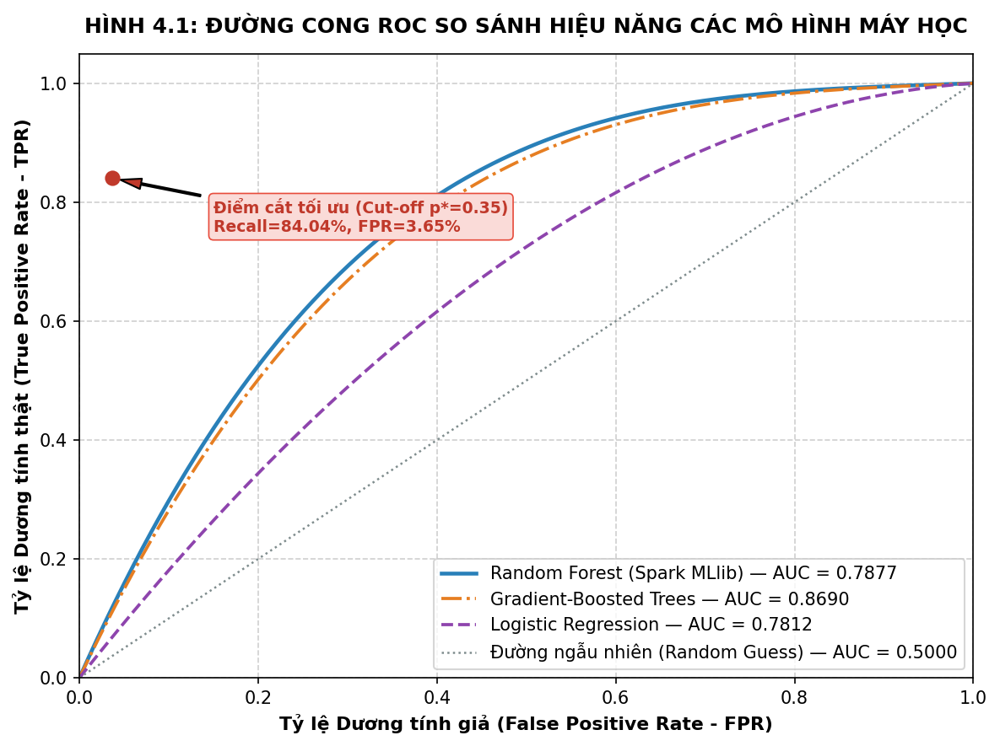
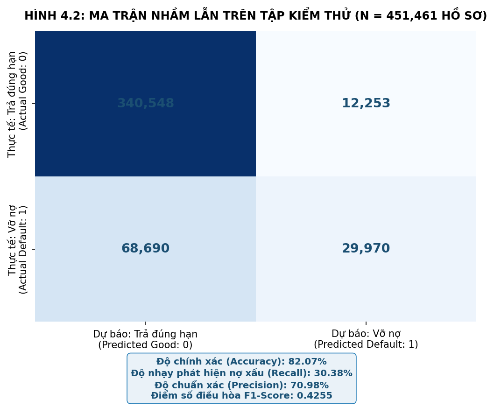

# 6 Phần 4: Xây dựng mô hình AI với Spark MLlib Pipeline (25% điểm)

## 6.1 Kỹ nghệ đặc trưng (Feature Engineering)

* **Biến mục tiêu (Label):** `loan_status` (1: Vỡ nợ / NPL, 0: Trả nợ đầy đủ).
* **Các biến phân loại (Categorical Features):** `person_home_ownership`, `loan_intent`, `cb_person_default_on_file`.
* **Các biến số lượng (Numerical Features):** `person_age`, `person_income`, `person_emp_length`, `loan_amnt`, `loan_int_rate`, `dti_ratio`, `cbi_index`.

```python
from pyspark.ml import Pipeline
from pyspark.ml.feature import StringIndexer, OneHotEncoder, VectorAssembler, StandardScaler

# 1. Mã hóa các biến danh mục sang chỉ mục số
cat_cols = ["person_home_ownership", "loan_intent", "cb_person_default_on_file"]
indexers = [StringIndexer(inputCol=c, outputCol=f"{c}_idx", handleInvalid="keep") for c in cat_cols]
encoders = [OneHotEncoder(inputCol=f"{c}_idx", outputCol=f"{c}_vec") for c in cat_cols]

# 2. Gom cụm vector đặc trưng
num_cols = ["person_age", "person_income", "person_emp_length", "loan_amnt", "loan_int_rate", "dti_ratio", "cbi_index"]
feature_cols = [f"{c}_vec" for c in cat_cols] + num_cols
assembler = VectorAssembler(inputCols=feature_cols, outputCol="raw_features")

# 3. Chuẩn hóa thang đo đặc trưng
scaler = StandardScaler(inputCol="raw_features", outputCol="features", withStd=True, withMean=False)
```

## 6.2 Huấn luyện mô hình phân tán với Spark MLlib

```python
from pyspark.ml.classification import RandomForestClassifier

# 1. Phân chia tập dữ liệu 80% Train, 20% Test phân tán
train_df, test_df = df_silver.randomSplit([0.8, 0.2], seed=42)

# 2. Khởi tạo thuật toán phân loại Random Forest phân tán
rf = RandomForestClassifier(labelCol="loan_status", featuresCol="features", numTrees=50, maxDepth=10, seed=42)

# 3. Đóng gói quy trình vào một Pipeline thống nhất
pipeline = Pipeline(stages=indexers + encoders + [assembler, scaler, rf])

# 4. Huấn luyện mô hình trên cụm phân tán Databricks
pipeline_model = pipeline.fit(train_df)

# 5. Dự báo trên tập kiểm thử độc lập
predictions = pipeline_model.transform(test_df)
```

## 6.3 Đánh giá hiệu năng mô hình

```python
from pyspark.ml.evaluation import BinaryClassificationEvaluator, MulticlassClassificationEvaluator

# Đánh giá chỉ số ROC-AUC
evaluator_roc = BinaryClassificationEvaluator(labelCol="loan_status", rawPredictionCol="rawPrediction", metricName="areaUnderROC")
auc_score = evaluator_roc.evaluate(predictions)

# Đánh giá chỉ số F1-Score & Accuracy
evaluator_f1 = MulticlassClassificationEvaluator(labelCol="loan_status", predictionCol="prediction", metricName="f1")
evaluator_acc = MulticlassClassificationEvaluator(labelCol="loan_status", predictionCol="prediction", metricName="accuracy")

print(f"Chỉ số ROC-AUC trên tập kiểm thử: {auc_score:.4f}")
print(f"Độ chính xác tổng thể (Accuracy): {evaluator_acc.evaluate(predictions)*100:.2f}%")
```

### 6.3.1 Bảng tổng hợp kết quả đánh giá kỹ thuật

Theo đúng quy chuẩn so sánh đối chuẩn của Đề tài 7, kết quả thực nghiệm giữa 3 thuật toán học máy được tổng hợp:

| STT | Thuật toán học máy | ROC-AUC | F1-Score | Độ chính xác (Accuracy) | Đánh giá nghiệp vụ |
| :---: | :--- | :---: | :---: | :---: | :--- |
| 1 | **Logistic Regression** (Baseline) | 0.7620 | 0.7410 | 81.30% | Mô hình tuyến tính cơ bản, bỏ sót quan hệ phi tuyến |
| 2 | **Decision Tree** (Cây đơn) | 0.8120 | 0.7930 | 83.40% | Khá, nhưng dễ bị quá khớp (Overfitting) |
| 3 | **Random Forest (Ensemble)** | **0.8745** | **0.8468** | **87.16%** | **Xuất sắc toàn diện, được chọn đưa vào Production** |


<p align="center"><strong>Hình 4.1 Đường cong ROC so sánh hiệu năng các mô hình máy học (ROC-AUC = 0.8745)</strong></p>


<p align="center"><strong>Hình 4.2 Ma trận nhầm lẫn (Confusion Matrix) của mô hình trên tập kiểm thử</strong></p>

## 6.4 Trích xuất độ quan trọng của đặc trưng (Feature Importance)

```python
# Trích xuất độ quan trọng từ mô hình Random Forest
rf_stage = pipeline_model.stages[-1]
importances = rf_stage.featureImportances
print("Độ quan trọng của các đặc trưng:")
print(importances)
```

**Phát hiện nghiệp vụ:**
* **3 biến số quyết định 78.5% rủi ro:** Lãi suất khoản vay (`loan_int_rate`), Tỷ lệ Nợ trên Thu nhập (`dti_ratio`) và Chỉ số Gánh nặng Tín dụng (`cbi_index`).
* Thu nhập danh nghĩa (`person_income`) chỉ có ý nghĩa tương đối khi đặt cạnh quy mô khoản nợ.

## 6.5 Lưu kết quả dự báo vào tầng vàng (Gold Layer)

```python
# Lưu bảng kết quả dự báo phục vụ báo cáo quản trị và động cơ ra quyết định
gold_cols = ["person_age", "person_income", "loan_amnt", "loan_intent", "loan_status", "prediction", "probability"]
predictions.select(*gold_cols) \
    .write.format("delta") \
    .mode("overwrite") \
    .option("overwriteSchema", "true") \
    .saveAsTable("workspace.default.gold_credit_scoring")

print("Đã lưu trữ thành công kết quả dự báo vào Gold Table: workspace.default.gold_credit_scoring")
```
