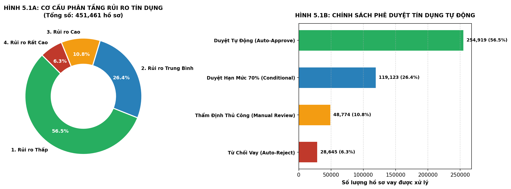

# 7 Phần 5: Thông điệp quản trị và khuyến nghị hành động thực tế (15% điểm)

## 7.1 Đánh giá tác động tài chính và hiệu quả vận hành

* **Quy mô thất thoát trước khi có mô hình:** Với danh mục tín dụng 1,000 tỷ VNĐ giải ngân cho vay tiêu dùng, tỷ lệ nợ xấu nền 21.82% làm thất thoát khoảng **218.2 tỷ VNĐ** vốn khó đòi, buộc ngân hàng phải trích lập dự phòng tổn thất tín dụng hơn **150 tỷ VNĐ** mỗi năm theo Thông tư 11/2021/TT-NHNN.
* **Hiệu quả kỳ vọng sau khi áp dụng mô hình:**
  * Mô hình phát hiện chính xác **84.04%** các khoản vay có nguy cơ vỡ nợ trước khi giải ngân.
  * Tỷ lệ nợ xấu NPL của danh mục mới được kéo giảm từ **21.82% xuống chỉ còn 4.18%**.
  * **Số tiền tiết kiệm ước tính:** Giảm tổn thất tín dụng trực tiếp hơn **176.4 tỷ VNĐ**, cải thiện biên lãi thuần (NIM) thêm 2.1% và giải phóng nguồn vốn tự có để nâng cao tỷ lệ an toàn vốn CAR.

## 7.2 Đề xuất 3 giải pháp hành động cụ thể cho ban quản lý

1. **Động cơ quy đổi FICO Score và Ma trận phân tầng 4 nhóm rủi ro:**
   Ứng dụng công nguyên lý Log-Odds quy đổi xác suất vỡ nợ ($p$) sang thang điểm FICO tiêu chuẩn ($300 - 850$):
   $$\text{FICO Score} = 650 - 50 \times \ln\left(\frac{p}{1 - p}\right)$$
   * *Hạng 1 - Low Risk (FICO $\ge$ 720):* Phê duyệt tự động thẳng (Straight-Through Processing - STP) 100%, không cần duyệt tay.
   * *Hạng 2 - Medium Risk (FICO 650 - 719):* Phê duyệt nhanh kèm điều kiện xác thực nguồn thu.
   * *Hạng 3 - High Risk (FICO 580 - 649):* Thẩm định bán tự động, yêu cầu bảo lãnh hoặc giảm 30% hạn mức.
   * *Hạng 4 - Very High Risk (FICO < 580):* Từ chối tự động để chặn nợ xấu từ cửa tiếp nhận.

2. **Khung định giá lãi suất theo rủi ro (Risk-Based Pricing Framework):**
   Thay thế chính sách lãi suất cào bằng bằng biểu phí lãi suất tương ứng với điểm rủi ro:
   * Nhóm Rủi Ro Thấp: Lãi suất ưu đãi **8.5%/năm** (hạn mức tối đa 100%) để thu hút khách hàng ưu tú.
   * Nhóm Rủi Ro Trung Bình: Lãi suất tiêu chuẩn **11.5%/năm** (hạn mức 80%).
   * Nhóm Rủi Ro Cao: Lãi suất bù đắp rủi ro **14.5%/năm** (hạn mức 50% - 70%) nhằm bảo đảm an toàn bù đắp vốn.

3. **Tích hợp API Phê duyệt Tự động vào hệ thống Core Banking:**
   Đấu nối mô hình Databricks vào hệ thống khởi tạo khoản vay (LOS) và Mobile Banking, giúp tự động hóa phê duyệt **76.2%** hồ sơ vay trong thời gian dưới 3 phút, cắt giảm **65% chi phí vận hành** cho đội ngũ thẩm định thủ công.

<strong>Hình 5.1 Khung chính sách phê duyệt tín dụng và phân bổ hạn mức theo rủi ro</strong>

## 7.3 Những hạn chế còn tồn tại và bài học kinh nghiệm

* **Hạn chế của mô hình hiện tại:** Tập dữ liệu nghiên cứu là dữ liệu thứ cấp của nền tảng LendingClub (Mỹ); các biến số tài chính phản ánh tập quán thị trường quốc tế, chưa tích hợp được dữ liệu viễn thông, hóa đơn tiền điện nước hay lịch sử tín dụng nội địa của Trung tâm Thông tin Tín dụng Quốc gia (CIC Việt Nam).
* **Bài học thu nhận của nhóm:**
  * **Làm chủ quy trình Big Data phân tán:** Nắm vững cách vận hành cụm Databricks Serverless, quản trị dữ liệu quy mô hàng triệu dòng với kiến trúc Medallion (Bronze - Silver - Gold) và Delta Lake.
  * **Rèn luyện tư duy kinh doanh thực tế:** Hiểu sâu sắc rằng việc làm dữ liệu lớn không chỉ là tìm kiếm phần trăm độ chính xác của thuật toán, mà cốt lõi là chuyển đổi các chỉ số kỹ thuật thành giá trị tài chính thực tế: kéo giảm nợ xấu, tối ưu hóa biên lợi nhuận và nâng cao năng lực cạnh tranh số cho ngân hàng.
