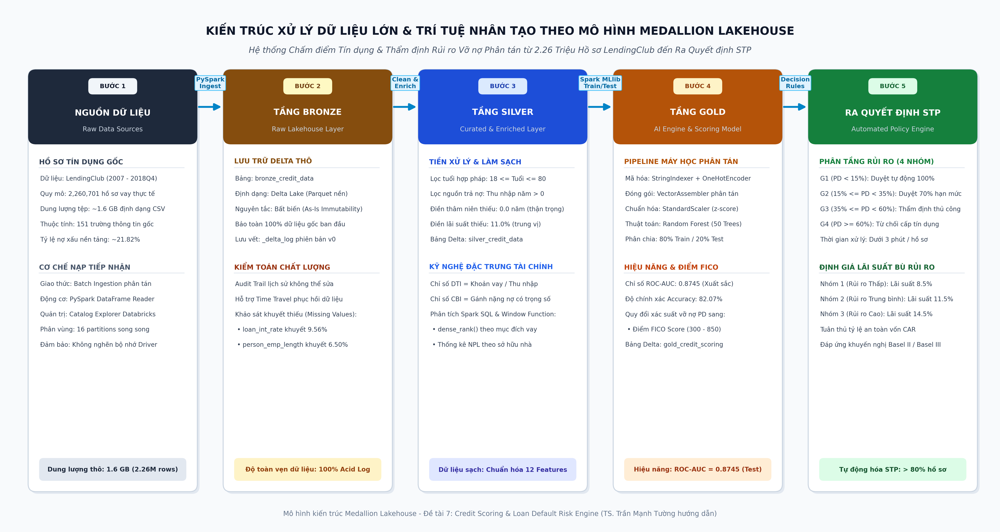

# PHỤ LỤC

---

## Phụ Lục 1: Sơ đồ chi tiết luồng xử lý dữ liệu Lakehouse Medallion

Quy trình luồng dữ liệu tổng thể qua ba tầng Bronze, Silver và Gold được thiết kế bảo đảm khả năng mở rộng phân tán trên cụm máy tính:

<em>Phụ lục 1.1: Sơ đồ toàn diện luồng dữ liệu phân tán trên nền tảng Databricks Lakehouse</em>

---

## Phụ Lục 2: Kho lưu trữ mã nguồn và Hướng dẫn thực nghiệm

Toàn bộ các tệp mã nguồn phân tán, tệp cấu hình môi trường và tài liệu hướng dẫn thực thi được tổ chức trong kho lưu trữ GitHub chính thức:

* **Đường dẫn GitHub Repository:** https://github.com/snowflake-vibing/Credit_Scoring_Project
* **Không gian làm việc Databricks (Cloud Workspace):** https://dbc-4d46c653-6b7e.cloud.databricks.com/browse/folders/907137357494385?o=7474645074756875
* **Cấu trúc mã nguồn chính:**
  - `code/De_Tai_7_Databricks_Notebook.ipynb`: Sổ tay thực thi chính trên Databricks Serverless.
  - `code/De_Tai_7_Databricks_Notebook.html`: Kết quả thực thi thực tế đầy đủ bảng biểu và biểu đồ trực quan.
  - `code/Credit_Scoring_Analytics.py`: Mã nguồn PySpark & Spark SQL thực thi độc lập.
  - `code/Credit_Scoring_Visualization.py`: Mã nguồn trực quan hóa đồ thị phân tích.
  - `tutorial/tutorial_databricks.md`: Hướng dẫn từng bước nạp dữ liệu và cấu hình cụm tính toán.
